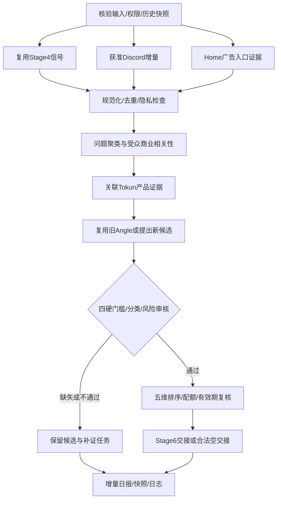

# Stage 5 设计：从用户问题到可制作的广告角度

版本：1.0.0；设计日期：2026-10-30；来源：《X Workflow》5.1–5.9及正式分类修订。

本文定义可供实现和人工执行的决策流程、数据契约、状态与验收。不是在线采集器或已经验收的历史实现。Stage 7不在本次范围。

## 1. 产品目标与边界

Stage 5回答：**哪个真实用户，在什么场景遇到什么问题，Tokun凭什么解决，应该测试哪一个承诺？**

输入为Stage 4已采集的X研究、Home中真实观察到的广告、获准Discord讨论、Tokun产品事实、已有Angle和Stage 8学习；输出为可追溯需求库、证据映射、Angle决策和Stage 6制作交接。

不负责Organic互动、文案三版本、广告图生成、投放、预算或成效判断。不把热点自动转成产品能力，不将痛点数量当Angle生产配额。

业务成功标准是来源与产品事实能支撑交接决策，包括合理的零交接；广告效果由后续真实实验验证。

## 2. 调用与运行模式

以下是未来执行入口的契约设计，不是目前可运行的CLI：

| 模式 | 用途 | 允许变化 |
| --- | --- | --- |
| `daily` | 日常增量研究及角度更新 | 在当日角度配额内创建/更新策略版本 |
| `review` | 对指定Angle版本补证或人工审核 | 写审核事件，不自动制作或投放 |
| `revalidate` | 证据到期、模型下架、落地页变化 | 更新有效性、撤销可用资格及影响清单；不受新增配额限制 |
| `replay` | 固定样本回归或同输入复跑 | 默认dry-run，无平台写入，不触发真实采集 |

运行请求包含：`run_id`、`mode`、`as_of`、`timezone=Asia/Shanghai`、`owner`、`account_handle`、`input_refs`、`previous_snapshot_ref`、`config_version`、`taxonomy_version`、`permissions_ref`、`output_root`、`dry_run`。

配置至少包括：来源窗口24小时/不足扩至72小时、Discord目标2条、每日实质变更Angle上限2个、优先交接1个、价格快照有效期24小时、来源许可范围、产品证据复核政策及语义审核责任人。非价格证据必须有明确有效期或复核规则；不得随意套用价格24小时或历史“7天”。

`output_root`须为授权持久目录，生产记录不默认写进Git。调度时间未指定：Stage 4的14:00不自动成为Stage 5调度授权或已注册任务。

## 3. 运行顺序与分支

1. 校验运行请求和旧库版本；权限缺失只阻断受影响来源。无可用输入时仍输出运行失败/阻断报告，不伪造空市场。
2. 读取Stage 4信号引用，不重新全量爬取。窗口内样本不足才扩至72小时并记录覆盖。evergreen与近期数据分列。
3. Discord增量读取已获准频道及上下文，附件先脱敏。无权限记录`blocked_permission`；其他来源继续。
4. Home入口按账号维护：真实标记、截图、链接、时间、handle。未观察到可继续研究/草稿；该账号的正式Stage 6交接保守阻断为`entry_unverified`。换号重新核验；同号历史证据保留其观察时间且不推断今天Ads资格。此为本设计的交接规则，区分于未来投放资格。
5. 对每条输入校验结构、来源、时间、隐私与重复性；单条坏数据隔离，保留有效部分。
6. 聚类、证据匹配、Angle变更提案；不明确时进入待审，不用关键词相似度代替产品判断。
7. 核验风险审批，排序后优先交接一个合格角度；生成引用型交接、影响清单和日报。
8. 提交快照前再次按`as_of`检查有效期、版本与引用一致性；Stage 6消费时还要重新检查，不能只信旧交接。

## 4. 数据资产及事实归属

所有资产使用`schema_version`、稳定ID、对象版本、创建/更新时间、来源引用。时间为带偏移ISO8601，未知字段用null并附原因，未知不填0。版本号仅在语义内容变化时增加，重复观测记日志而不制造新版本。

| 文件 | 主键 | 最低业务字段 | 事实责任 |
| --- | --- | --- | --- |
| `discord-pain-points.json` | pain_id + version | 平台/频道/message/thread/source_url、发布时间/采集时间、user_context、problem、expected_outcome、attempted_actions、resolution_status、attachment_refs、privacy_check、duplicate_of | Discord授权上下文中的用户问题 |
| `ad-signals.json` | signal_id + version | event_id、source_type/platform、外部对象ID、source_url、author_role、published_at、collected_at、read_scope、comment_sort、question、audience、evidence_status、dedup_key、pain_refs | 原始观察；引用Discord痛点而非复制维护其事实 |
| `audience-insights.json` | insight_id + version | audience、usage_context、pain_point、desired_outcome、signal_refs、独立作者/线程样本、buying_relevance、trend_relevance、counter_evidence、confidence | 聚类解释，保留不确定性 |
| `product-evidence.json` | evidence_id + version | capability、supported_claim、source_ref/url、source_kind、verified_at、expires_at、scope_or_limit、verification_method、approval_status、affected_angle_refs | Tokun可兑现事实，不从用户抱怨推出 |
| `angles.json` | angle_id + angle_version | WHO/WHY、insight/signal/evidence引用、single_claim、english_message、creative_direction、cta、landing_url、primary_event、风险与审核、分类与映射、评分、有效期、生命周期 | 唯一策略主库 |
| `stage5-handoff.json` | handoff_id | 运行/版本/时间、固定Angle及证据引用、状态/空原因、制作所需快照字段 | 从主库导出的不可变交接，不是第二套Angle事实库 |

五个长期主库加一个交接包；运行层另外保存`run-manifest.json`、`change-log.jsonl`、`invalidation-events.json`和`stage5-daily-report.md`。外部文档若使用signals.json别名，通过显式路径映射接入，不维护两份主库。

ID生成策略：新对象创建一次opaque ID并持久化；外部平台ID用于查重，不将含个人信息的正文拼入ID。已有ANG-*完整沿用。任何迁移须提供old→new映射，不从标题生成易变ID。

## 5. 去重、聚类与语义责任

分开处理三个问题：

- **同一记录**：以平台+外部对象ID精确upsert；相同消息的多个附件不是多条问题。变更内容新增修订，旧观察仍可追溯。
- **同一事件**：官方发布、Founder转述、跨平台转载归入同一event_id，不重复计算市场事件。不同真实用户的独立经历保留独立来源。
- **同一痛点/Angle**：相同用户任务、障碍、期望结果归入现有问题簇；新增独立案例计`new_evidence`，非`new_pain_points`。仅换文案同义词不新建Angle。

语义候选由分析执行者（AI或人工）提出，必须给合并/拆分理由、证据引用和置信说明。明确同一事件可自动合并；不确定时`pending_semantic_review`，不默认两个痛点也不强合并。自动语义判断是未来可替换能力，MVP允许人工确认的映射输入，但须如实标明。

Discord日报分别统计新增独立痛点、既有痛点新增证据、解决/待核实、已读消息与线程、时间覆盖。若只有0–1个独立问题，说明原因；不以扩大读取权限或切碎附件凑数。

## 6. Angle结构与分类规则

一张Angle是“一个主要受众+一个使用情境+一个可测试承诺”，不是一个形容词或配色方案。

必填语义字段：`audience`、`context`、`pain_point`、`desired_outcome`、`single_claim`、`signal_refs`、`insight_ref`、`evidence_refs`、`scope_or_limit`、`counter_evidence`、`english_message`、`creative_direction`、`cta`、`landing_url`、`primary_event`。

分类字段：`taxonomy_version`、`primary_family`、`secondary_tags`、`mapping_status`、`mapping_history`、`derived_from_angle_id`。primary_family从以下正式六类选一个；无法确定保持pending_mapping，不能交接。

| Family | 主要购买动机 | 易混边界 |
| --- | --- | --- |
| Price-led | 单价、计费、预算、总任务成本 | 核心承诺便宜才归Price，可信披露归Trust |
| Friction-led | 接入、配置、迁移阻力 | 统一API接入便利归Friction，生态自由归Choice |
| Trust-led | Transparency或有实测支持的Reliability | Provider透明≠可自主选择Provider |
| Value-led | 非价格效率、工作成果、开发体验 | 不为填满类别强造价值或性能证据 |
| Choice-led | 模型/Provider选择、生态自由、独立性 | 模型+价格按主承诺判，另一个做tag |
| Trial-led | 首次验证及付费尝试风险 | 真实试用条件必须核验，不捏造优惠 |

旧映射：ANG-price→Price；ANG-model-price→pending_mapping；ANG-integration→Friction；ANG-model-choice→Choice；ANG-pricing-clarity→Trust/Transparency；ANG-agent-cost→Price；ANG-provider→Trust/Transparency；ANG-paid-trial→Trial。具体内容缺失时只保留映射规则，不创建或批准虚构历史对象。

新Family形成proposal（独立购买动机、与六类差异、真实需求证据、可测试候选），人工批准/合并/延期/拒绝后才发布taxonomy版本。正式分类变化不覆盖历史实验。

## 7. 决策门槛与风险审核

决策函数的输入是固定Angle版本、固定证据版本、审核事件、入口证据和`as_of`；输出为`eligible`、`reason_codes[]`及待办，不靠总分绕过硬门槛。

四个业务门槛：

1. 受众相关：明确已有API支出开发者或即将部署Agent的建设者，问题与商业行为有联系。
2. 来源可追溯：能定位实际已读讨论，标明自述、截图内容、确认事实与推断。
3. 产品证据：单一承诺在适用模型、接口、条件和期限内被Tokun事实支持。
4. 落地页兑现：链接可访问，正文确实支持该承诺与CTA，不以无关表单替代购买路径。

另检查正式分类映射、审核绑定版本、证据时间、隐私、账号入口及下游可解析引用。价格对比必须同日同模型版本、相同单位和计费条件，区分输入/输出、缓存、上下文、批处理。成本节省需工作负载及质量/成功率证据，不能只从token价得出。

| 风险 | 内容 | 通过方式 |
| --- | --- | --- |
| low | 当期可直接核验的纯事实 | 规则检查+可追溯事实核验均通过才可自动审核 |
| medium | 动态模型/价格、附条件能力 | 可靠实时核验且匹配已有政策；无政策或任一不明转人工 |
| high | 节省率、性能、可靠性、竞品比较、客户成果 | 指定人工审核者核验当前版本 |
| unknown | 无法判级 | 人工处理，不降级为low |

审核记录含review_id、angle_id/version、evidence_refs、risk_level、review_method、reviewer、policy_ref、decision、reviewed_at、expires_at、reason。只记录待审不能算批准。撤回或修改核心字段使旧批准不再适用于新版本。

硬门槛与审批通过后按五维评分，各0–2：受众相关度、问题具体性、产品匹配、时效、素材差异；每项附依据，总分0–10。缺产品证据保留null/待评，不用高其他分抵消。只在合格集合内排名；同分优先证据完整且更近期。分数不是效果预测，不设“8分必胜”。

## 8. 生命周期、版本与每日配额

生命周期与有效性分离，避免用“已交接”误判“仍可制作”：

- `lifecycle`：new→needs_evidence→ready_for_creative→handed_off→testing→retained/revise/retired。
- `validity`：valid/expired/revoked/landing_unavailable。
- `approval_status`：pending/approved/rejected/revoked。
- `mapping_status`：pending_mapping/confirmed。

交接资格是派生结果：生命周期允许、valid、审核approved且版本相符、mapping confirmed、四门槛通过、入口已核验。兼容旧`status`字段时显式导出映射；旧handed_off映射为“有交接历史”，不能直接当有效资格。

版本规则：新增独立来源可只更新证据关联及日志；核心承诺、受众/场景、限制、落地页兑现范围或审核依据实质变化产生新Angle版本并重审。Hook/措辞/视觉变化留给Stage6；新购买承诺需判断新Angle并存derived_from引用。

每日最多新增或实质更新2个Angle（Asia/Shanghai自然日，跨同日多个run累计，而非每次重置）；优先生产其中1个。只做证据补充、无变更复核或紧急失效不人为占新增配额；新增证据导致实质策略变更则计入。更多提案入backlog，保留来源；无新信息只查有效期，不为了日报凑角度。

## 9. Stage 6交接协议

完整字段契约见[交接模板](../../.agents/skills/tokun-stage5-ad-intelligence/references/handoff-template.json)。模板是合法空交接样例，不是实际运行结果。

`items`每项必须保存angle_id/angle_version、taxonomy_version、primary_family、mapping_status、固定evidence_refs及兼容evidence_ids、claim、audience、cta、landing_url、primary_event、creative_direction、required_qualifiers、risk_level、review_method、approval_status、reviewed_at、expires_at、status=ready_for_creative。

`expires_at`取交接所依赖证据、审批和Angle期限的最早值。交接带source_snapshot_ref和checksum，引用已提交快照；重发同一输入保持相同decision_key，避免Stage6重复创建任务。handoff_id可以标记一次不同导出，消费者用decision_key（Angle版本+制作范围+证据/批准版本）幂等消费。

空交接：items=[]、handoff_status=empty、empty_reason非空，给reason_codes与下一步。依来源失败应说“无法判断”，而非“没有需求”。部分来源阻断但剩余来源支撑资格时可交接，保留coverage_warning。

`launch_authorized=false`不可由调用方改为true。Stage5制作批准从不代表Stage7预算/投放授权。Stage6不能自行修改承诺、补写审核或提升needs_evidence；应返回change_request，含被影响Angle/版本、原因、请求变更、证据缺口。

## 10. 失效传播与恢复

触发：价格/目录过期、能力下架、证据撤回、审核撤销、落地页失效。由evidence→angle→copy/image→creative→已知冻结实验引用生成影响清单。

每个失效事件保存event_id、trigger、source_ref、detected_at、affected_objects、required_action、ack_status。下游注册表不可用时明确`impact_scope=incomplete`，列待补查询，不声称已通知全部资产。

禁止删除旧版本或偷偷改正在使用的内容。Stage5可撤销制作资格、发复核任务；不能自动暂停广告或改预算。恢复必须有新核验/审核事件，已变化的主张生成新版本，Stage6重新消费资格。

## 11. 持久化、幂等与故障恢复

推荐持久布局：`stage5/runs/<run_id>/`存输入引用、暂存输出、日志和运行manifest；`stage5/snapshots/<snapshot_id>/`为不可变主库快照；`current`清单指向完整快照。Notion是审阅投影，不是并行维护的事实主库。

提交顺序：固定输入及as_of→生成暂存资产→检查主外键/状态/配额→提交不可变快照→原子更新current→生成绑定快照的交接→更新Notion投影。单写者锁或等效compare-and-swap校验base_snapshot，冲突重读并重新决策，不覆盖别人的提交。

同一输入、配置、as_of和语义确认映射应得到相同业务对象/版本；真实时间/新政策属于新输入。原始run日志可追加，重复执行不能多记Angle配额、Discord痛点或制作任务。

上传/Notion失败保留已成功快照并记录sync_pending；交接失败重试导出，不重跑Angle生成。来源暂时失败只重试失败读取，保留退避和尝试次数；永久拒绝不循环请求。输出未通过验证时不更新current，也不发交接。

## 12. 日报与错误契约

日报固定内容：数据截止与实际范围、按来源成功/阻断状态、独立痛点与新证据计数、Angle新增/实质更新/不变/过期、审核队列、排序理由、交接及空原因、受影响资产、人工待办与下一步。

错误包含code、stage_step、source_ref、retryable、partial_outputs、owner、next_action。建议code：input_missing、schema_invalid、blocked_permission、source_unavailable、entry_unverified、pending_semantic_review、needs_evidence、pending_review、pending_mapping、expired、landing_unavailable、empty_handoff、snapshot_conflict、sync_pending。

business_verified、code_integrated、regression_passed、live_enabled、permissions分别记载及附证据；设计完成只说明设计，不填真实业务通过。手工执行亦可交付真实研究，但不能宣称采集/语义判断/调度已自动化。

## 13. 验收与实现顺序

完整场景见[验收矩阵](acceptance.md)。离线测试使用脱敏固定输入、冻结时钟及可审阅语义映射；不得发真实帖子、创建广告或付款。真实接入另做授权只读验收，不能用fixture替代。

实现顺序：

1. 先实现版本化主库、字段校验、时间/状态/引用/配额、日志和原子提交。
2. 接Stage4导出与获准Discord导出；先支持人工审阅语义映射，验证去重/证据/分类决策。
3. 实现风险审核记录、Angle排序、交接及下游消费契约测试。
4. 接真实授权只读来源、产品核验和Notion投影；独立验证每个适配器。
5. 回归通过后才考虑调度；自动语义增强须保留解释及待审分支。

完成标准：同一输入复跑无重复策略/配额；缺证据和审批绕不过；有资格角度可输出固定交接，无资格可解释空交接；失效能撤销制作资格并定位已知下游；每个决定有来源、版本、时间、负责人和缺口。Stage7无实现不影响这些验收。
